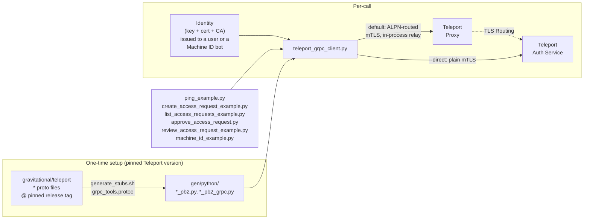
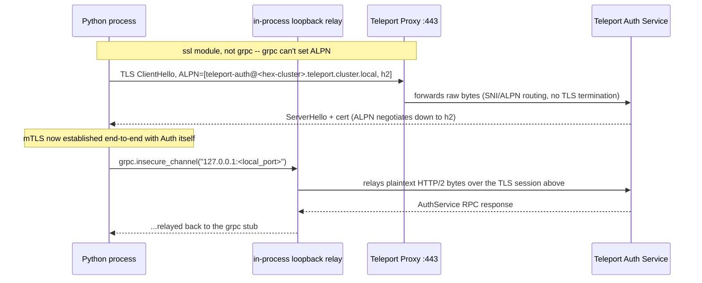
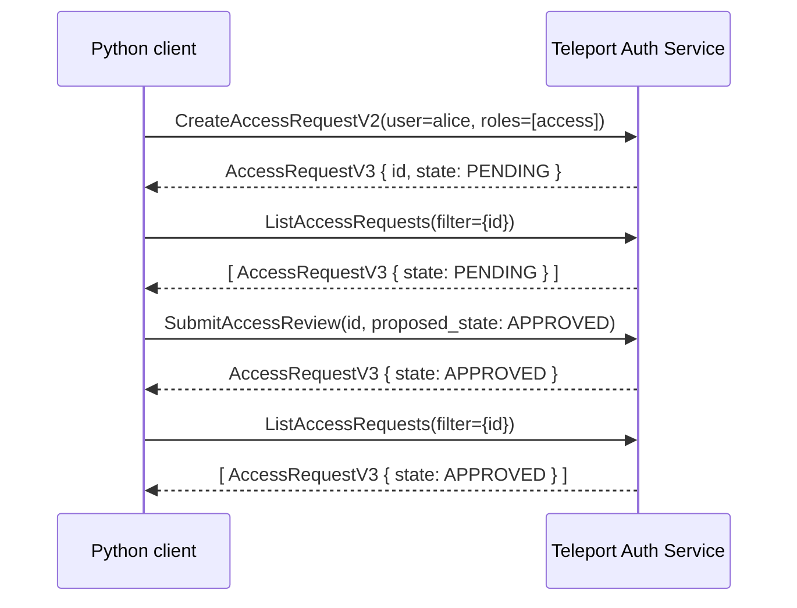

# Teleport Auth Service — Python gRPC Examples

Teleport's control plane (the Auth Service) is a gRPC server. Everything
`tctl`/`tsh` do — pinging the cluster, managing access requests, users,
roles, nodes, etc. — happens over that gRPC API. Teleport doesn't ship an
official Python client for it, but since it's just gRPC + protobuf, you can
generate your own bindings from Teleport's open-source `.proto` files and
call it directly from Python.

This folder does exactly that: compiles real stubs from
[gravitational/teleport](https://github.com/gravitational/teleport)'s
`api/proto`, and uses them to call `AuthService` — the same service
`tctl`/`tsh` talk to — for a few common operations.

Every script here was run against a real Teleport cluster before being
committed — a disposable local test cluster, a real internal cluster, and
a real Enterprise-licensed demo cluster, over both connection modes
described below. This isn't "should work" sample code; every claim in
this README was checked against a live Auth Service.

**Prior art:** [hugoShaka/teleportpy](https://github.com/hugoShaka/teleportpy)
(a Teleport engineer's prototype) independently hit and solved the same
core ALPN-routing problem this folder solves (see "Connecting through a
Proxy" below) — worth a look, though it's an unmaintained proof-of-concept
with a narrower scope (one `ListUsers` example, no access requests, no
Machine ID). Teleport's own
[issue #32658](https://github.com/gravitational/teleport/issues/32658)
("Provide non-Go API client examples for gRPC API") was closed
not-planned in 2024 — official confirmation there's no official Python
client and no plan to build one.

## Quick start

### Step 1 (required): generate the stubs

**`gen/` is not checked into this repo** — it's ~7 MB / 400+ files of
generated code, and keeping that out of git history is worth the one
extra command. Nothing here runs without it:

```bash
./generate_stubs.sh
```

This is self-contained — it creates its own throwaway `.venv-stubgen/`
for `grpcio-tools` (so it works even on a Homebrew-managed Python that
refuses system-wide package installs; see below), fetches Teleport's
`.proto` files at a pinned version, and compiles `gen/python/`. Takes a
few seconds, needs network access, nothing else. See "Versioning &
upgrading" below for what the pinned version means and when to bump it.

### Step 2: install the runtime dependencies

Use a venv — do this by default, don't wait to hit an error first:

```bash
python3 -m venv .venv
.venv/bin/pip install -r requirements.txt
.venv/bin/python3 simple_ping_example.py   # use .venv/bin/python3 for every script below
```

That's `grpcio` and `protobuf` — the two runtime dependencies the
*examples themselves* need (the generated `gen/python/*_pb2.py` files
import `google.protobuf` directly; it's not a guaranteed transitive
dependency of plain `grpcio`, so it's listed explicitly rather than
relying on something else happening to pull it in). This is separate
from `generate_stubs.sh`'s own `.venv-stubgen/` above — that one's just
for the one-time compile step and isn't used when running the examples.

**Why a venv by default, not just `pip3 install -r requirements.txt`:**
on a Homebrew-managed Python (common on macOS), that fails outright with
an "externally managed environment" error (PEP 668) — this has bitten
real people testing this, repeatedly, not a hypothetical edge case. If
you've confirmed your `python3`/`pip3` isn't Homebrew-managed (check with
`python3 -c "import sys; print(sys.executable)"` — Homebrew's is
typically under `/opt/homebrew/...`), plain `pip3 install -r
requirements.txt` works fine too. Either way, don't reach for
`--break-system-packages` — the venv sidesteps the problem entirely and
is the generally correct way to run a script with its own dependencies
regardless of this specific error.

### Step 3: already `tsh login`'d? Just run it.

If you're in a shell with an active `tsh` session, every script here
falls back to reading that profile directly from `$TSH_HOME` (or
`~/.tsh`) — the same plain files `tsh` itself writes — whenever
`identity.key`/`.crt`/`.cas` aren't present locally. No flags needed:

```bash
python3 simple_ping_example.py
```

This reads your proxy address, cluster name, and credentials straight
from the profile and connects through the proxy (the default mode — a
tsh profile's address is the Proxy, essentially always). If
`TELEPORT_PROXY`/`TELEPORT_CLUSTER` happen to already be set in your
shell to something else, those win — `unset` them first if that's not
what you want.

One real limitation, not a bug: if your tsh identity uses a
hardware-backed key (PIV/YubiKey — some environments enforce this), there
is no raw private key to read, and this fails with a clear error. That's
inherent to this environment's security policy, not something a Python
TLS library can work around — see "Connecting through a Proxy" below for
why Go's tooling doesn't hit this (it uses `crypto.Signer`, a pluggable
signing interface Python's `ssl` module has no equivalent for). Use a
Machine ID bot (Option A below) instead; those always have a software key.

Everything below is for when you want to be explicit about which
identity to use (e.g. Machine ID) rather than relying on your current
session.

### Step 4: get an identity (your mTLS credentials)

Every example authenticates via an identity: a private key + client
certificate + CA chain. You have two options:

**Option A — Machine ID (recommended, and what `machine_id_example.py` is
built around).** This is how an automated/unattended caller should get
credentials. A cluster administrator creates a bot and a one-time join
token:

```bash
tctl bots add my-bot --roles=access-request-admin,access
```

Then, using the join token that command prints, fetch a short-lived
identity:

```bash
tbot start identity \
  --destination=file:///path/to/tbot-identity \
  --storage=file:///path/to/tbot-storage \
  --proxy-server=<cluster-proxy-host>:443 \
  --token=<join-token-from-above> \
  --join-method=token \
  --oneshot
```

This writes several files into the destination directory. The three
`machine_id_example.py` reads are `key`, `tlscert`, and
`teleport-host-ca.crt` (the CA that signed the Auth Service's own
certificate). In production, drop `--oneshot` and run `tbot` as a
long-lived process so it keeps renewing the identity in the background.

Note: Machine ID bots cannot be access-request **requesters** — Teleport
rejects `CreateAccessRequestV2` for a bot identity with `INVALID_ARGUMENT`
by design (access requests are a human-escalation workflow). Bots work
fine as **reviewers** (`approve_access_request.py`).

**Option B — a human user's identity.** If you're testing interactively,
any mechanism your cluster admin provides for issuing a user identity file
works the same way — it's still just a key/cert/CA triple, and
`teleport_grpc_client.py` doesn't care how it was produced.

Whichever option you use, the RBAC gotchas below apply to it.

The identity's roles need appropriate RBAC. Three gotchas worth knowing:

- **Creating** an access request doesn't require a special grant — it's
  essentially always available to an authenticated identity (except bots,
  per the note above).
- **Listing/reading** access requests over gRPC (`ListAccessRequests`,
  `GetAccessRequestsV2`) silently returns *zero results* — no error — if
  the caller's roles don't grant `list`/`read` on the `access_request`
  resource. The built-in `editor` preset role does **not** include this.
  Give your identity a role like:

  ```yaml
  kind: role
  version: v7
  metadata:
    name: access-request-admin
  spec:
    allow:
      rules:
      - resources: [access_request]
        verbs: [list, read, create, update, delete]
  ```

- **Reviewing** a request via `SubmitAccessReview`
  (`approve_access_request.py` — the real `tsh request approve` call) has
  a *different* authorization check: the reviewer's role needs
  `allow.review_requests.roles` listing the requested role, e.g.:

  ```yaml
  kind: role
  version: v7
  metadata:
    name: access-request-reviewer
  spec:
    allow:
      review_requests:
        roles: ["access"]
  ```

  **`allow.review_requests` is an Enterprise-only field** — on an
  unlicensed/OSS cluster, creating a role with it fails outright, and
  `SubmitAccessReview` can never succeed for anyone, regardless of role.
  Use `review_access_request_example.py` (`SetAccessRequestState`) there
  instead — see its docstring for how the two calls differ.

### Step 5: pick a connection mode

Every example takes the same connection flags (`--help` on any of them
shows the full list).

**Via proxy (default)** — the realistic case for most deployments,
including any Machine ID bot that only has network access to the public
Proxy (see "Connecting through a Proxy" below):

```bash
python3 ping_example.py --proxy <proxy-host>:443 --cluster-name <cluster> \
  --key identity.key --cert identity.crt --cas identity.cas
```

**Direct (`--direct`)** — you have network-level access to the Auth
Service's own port (on-prem, same host, VPN):

```bash
python3 ping_example.py --direct --proxy <auth-host>:3025 --tls-server-name <nodename> \
  --key identity.key --cert identity.crt --cas identity.cas
```

`--cluster-name` (default mode) is the cluster's name as Teleport knows
it, used to build the ALPN routing protocol string. `--tls-server-name`
(`--direct` mode) must match a SAN on the Auth Service's host certificate
(its nodename, by default) — if you see `UNAUTHENTICATED: Hostname
Verification Check failed`, this is the fix.

### Step 6: run the examples

```bash
python3 ping_example.py --proxy <proxy-host>:443 --cluster-name <cluster> ...
python3 machine_id_example.py --proxy <proxy-host>:443 --cluster-name <cluster> ...

python3 create_access_request_example.py --proxy <proxy-host>:443 --cluster-name <cluster> ...
# -> prints a request id

python3 list_access_requests_example.py --proxy <proxy-host>:443 --cluster-name <cluster> ...

# the real tsh request approve/deny call (needs an Enterprise-licensed cluster + reviewer role):
python3 approve_access_request.py <request-id> --proxy <proxy-host>:443 --cluster-name <cluster> ...

# the raw admin-override state set (works anywhere, bypasses review semantics):
python3 review_access_request_example.py <request-id> --proxy <proxy-host>:443 --cluster-name <cluster> ...
```

(Add `--direct` and swap `--proxy`/`--cluster-name` for
`--proxy`/`--tls-server-name` for direct mode.)

## How it fits together



- **Proto → Python** happens once (or whenever you deliberately bump the
  pinned Teleport version — see "Versioning & upgrading" below).
  `generate_stubs.sh` fetches the `.proto` definitions at that version and
  compiles them into `gen/python/`.
- **Identity** is an mTLS client certificate issued by the cluster. It can
  belong to a human user, or (the recommended approach for
  unattended/automated callers) a **Machine ID bot** managed by `tbot`.
  Either way, it's the same three things: a private key, a client
  certificate, and the CA to trust the server with.
- **Connection mode** defaults to routing through a Teleport Proxy — the
  way most real deployments require — with `--direct` to opt out and dial
  the Auth Service's own port instead. See the dedicated section below —
  this isn't a minor detail, it took real work to get right.
- **Each example script** builds a gRPC stub this way and calls one RPC on
  `AuthService`.

## Connecting through a Proxy (the default)

Most real Teleport clusters only expose the Proxy publicly (e.g. port
443) — not the Auth Service's own listening port. A pure Python gRPC
client reaching Auth *through* that proxy turned out to be the hard part
of this whole exercise, worth documenting properly rather than glossing
over.

**Why `grpc-python` can't just dial the proxy normally:** Teleport routes
different protocols (SSH, Postgres, Kubernetes, Auth API, ...) through
that single public port using the TLS ClientHello's ALPN extension — a
technique Teleport calls "TLS Routing." To reach Auth specifically, the
client has to offer the ALPN protocol
`teleport-auth@<hex-encoded-cluster-name>.teleport.cluster.local`
(derived from `api/constants.ALPNSNIAuthProtocol` and
`api/utils.EncodeClusterName` in Teleport's source) so the Proxy's router
knows to forward the raw bytes to Auth rather than treating it as a
generic web/API request. Teleport's own Go tooling (`tsh`, `tctl`, the
Go API client) can do this because `grpc-go` lets a caller fully own the
transport (`grpc.WithContextDialer`) — the Go code does its own TLS+ALPN
handshake, then hands the resulting connection to `grpc-go`.
**`grpc-python` has no equivalent public hook.** It's a Cython binding
onto grpc's C-core, which owns the entire TCP+TLS lifecycle internally;
there's no documented channel option to set a custom ALPN protocol list.

**What `teleport_grpc_client.py` does about it:** performs that TLS+ALPN
handshake itself with Python's `ssl` module (which *does* expose ALPN
control), then relays grpc's plaintext HTTP/2 bytes into that
already-authenticated connection over a local loopback socket that
`grpc.insecure_channel` connects to. Entirely in-process — no cluster-side
configuration, no `tsh`/`tctl` subprocess, no external relay tool.



One cert-verification subtlety, spelled out here because it's easy to get
wrong: the TLS SNI sent during the handshake must be the **Proxy's own
public hostname** (that's what its router keys off to decide where to
forward bytes), but the certificate that actually comes back is the
**Auth Service's host certificate**, issued for Teleport's fixed internal
domain `teleport.cluster.local` — not the Proxy's hostname. So hostname
verification has to target `teleport.cluster.local`, decoupled from the
SNI value used for routing. The certificate chain itself is still fully
validated against the real Auth host CA the whole time; nothing about
trust is weakened, the verification target is just different from the
SNI. This is the same split Teleport's own Go client makes internally.

**Caveat:** this derives the ALPN protocol scheme and SNI/hostname split
by reading Teleport's source (`api/constants`,
`lib/srv/alpnproxy/auth/auth_proxy.go`) — it isn't a published, versioned
client API contract the way the `.proto` files are. It could change in a
future Teleport release without notice. Re-verify after bumping
`TELEPORT_VERSION` (see "Versioning & upgrading"), same as everything
else generated/derived from source in this folder.

### Access request lifecycle (what most of the examples walk through)



Verified for real: two separate users (`alice`, `bob`) each created a
pending request; a properly-authorized reviewer approved `alice`'s
specifically via `SubmitAccessReview`; `bob`'s was confirmed still
`PENDING` afterward — proof this is a precise, authorized state
transition, not a blanket write.

## Folder contents

| File | What it does |
|---|---|
| `requirements.txt` | The two runtime dependencies (`grpcio`, `protobuf`). `pip3 install -r requirements.txt`. |
| `generate_stubs.sh` | **Run this first.** Pulls Teleport's `.proto` files (at a pinned version) + deps and compiles them to `gen/python/`, using its own throwaway `.venv-stubgen/`. |
| `gen/python/` | Generated output — **not checked into git** (~7 MB / 400+ files; see "Versioning & upgrading" for why that tradeoff was made). Produced by `generate_stubs.sh`. |
| `gen/TELEPORT_VERSION` | Which Teleport release tag `gen/python/` was generated from (also written by `generate_stubs.sh`). |
| `teleport_grpc_client.py` | Shared helper: builds an mTLS-authenticated `AuthServiceStub`, routed through a Proxy by default or directly with `--direct` (see above). Also the shared argparse connection flags every example uses. |
| `ping_example.py` | Connectivity check — `AuthService.Ping`. |
| `create_access_request_example.py` | Creates a pending access request (`CreateAccessRequestV2`), then confirms it exists (`ListAccessRequests`). |
| `list_access_requests_example.py` | Lists all access requests (`tctl requests ls` equivalent). |
| `approve_access_request.py` | Approves/denies a request via `SubmitAccessReview` — the exact call `tsh request approve`/`deny` make. Needs an Enterprise-licensed cluster and a reviewer role. |
| `review_access_request_example.py` | Approves/denies a request via `SetAccessRequestState` — a direct, unconditional admin-override state set that bypasses review/threshold semantics entirely. Works on OSS. |
| `machine_id_example.py` | Same `Ping` call, but authenticated as a Machine ID bot via `tbot` instead of a user identity. |

## Versioning & upgrading

**`generate_stubs.sh` is pinned to a specific Teleport release tag**
(`TELEPORT_VERSION` at the top of the script, currently `v18.10.0` — the
version these examples were last verified against), not whatever is
currently on `master`. This is deliberate, not an oversight:

- Teleport's proto definitions change between releases — fields get added,
  RPCs get deprecated or renamed, whole services get introduced. Pinning
  means every clone gets byte-identical stubs for a known-good version,
  not whatever happened to be on `master` the day someone ran the script.
- `gen/python/` is deliberately **not checked into git** — ~7 MB / 400+
  generated files isn't worth carrying in history when regenerating it
  is one fast, deterministic command. `gen/TELEPORT_VERSION` (also
  generated, also not checked in) is always the source of truth for
  "what version is this built against," not something to track separately.

**If you're upgrading the pinned version:**

1. Bump `TELEPORT_VERSION` in `generate_stubs.sh` to the new tag, as its
   own commit.
2. Re-run `./generate_stubs.sh`.
3. **Re-run every example script against a real cluster before pushing
   that commit.** A stub set that compiles cleanly can still fail at
   runtime — a field might get renamed, a request message's required
   fields might change, an RPC might be deprecated in favor of a new one.
   Compilation succeeding only proves the `.proto` syntax is valid, not
   that these examples still call it correctly.

As a rule of thumb, keep the pinned version reasonably close to the
Teleport version your actual cluster runs — Teleport generally supports
limited client/server version skew (see Teleport's own compatibility
docs), but these are raw proto definitions, not a version-negotiating
client, so there's no runtime compatibility shim protecting you if you
pin something wildly newer or older than your cluster.

**Automatic check, not just a rule of thumb to remember:** every example
that calls `Ping` also calls `teleport_grpc_client.check_server_compatibility()`
with the live server's version from the response. It compares that
against `gen/TELEPORT_VERSION` and prints a warning to stderr (not a hard
failure — the call already succeeded) if the major versions differ by
more than 1. It won't catch everything (a single-major-version bump can
still rename a field), but it turns the common case of "I forgot to
regenerate stubs after upgrading the cluster" into a visible warning
instead of a confusing failure three calls later.

## Trying it against a disposable local cluster

You don't need a shared cluster to try this — a single `teleport` binary
can run a throwaway auth-only cluster:

```bash
curl -sL -o teleport.tar.gz \
  https://cdn.teleport.dev/teleport-v18.10.0-linux-amd64-bin.tar.gz
tar xzf teleport.tar.gz

cat > teleport.yaml <<'EOF'
version: v3
teleport:
  nodename: local-test
  data_dir: ./data
auth_service:
  enabled: "yes"
  cluster_name: local-test-cluster
  listen_addr: 127.0.0.1:3025
  proxy_listener_mode: multiplex
proxy_service:
  enabled: "yes"
  web_listen_addr: 127.0.0.1:3080
ssh_service:
  enabled: "no"
EOF

./teleport/teleport start --config=teleport.yaml &

# ./generate_stubs.sh if you haven't already (see "Quick start" above),
# then create a role with the RBAC rule from there, and use tctl/tbot
# (both in the same tarball) to get an identity as shown above.
```

(If you're running this inside a Teleport Beams sandbox, `unset
TELEPORT_AUTH_SERVER TELEPORT_PROXY TELEPORT_CLUSTER` first — those env
vars point `tctl`/`tbot` at the *real* cluster and collide with a local
one.)

This downloads the plain OSS `teleport` binary, which means
`approve_access_request.py` (`SubmitAccessReview`) can never succeed here
— `allow.review_requests` is Enterprise-only (see the RBAC gotcha in
"Quick start"). Use `review_access_request_example.py` instead for a
full local demo.

## Expanding this to other RPCs

`AuthService` (in `gen/python/teleport/legacy/client/proto/`) is Teleport's
original, monolithic gRPC service and covers most day-to-day operations —
users, roles, tokens, sessions, locks, MFA, and more, in addition to access
requests. To find another RPC to call:

1. Look through `api/proto/teleport/legacy/client/proto/authservice.proto`
   (fetch a fresh copy, or re-run `generate_stubs.sh` which clones it into
   a temp dir) for the `rpc` you want on the `AuthService` definition.
2. Find its request/response message types — usually in the same file or
   in `api/proto/teleport/legacy/types/types.proto`.
3. Call it the same way the examples do:
   `stub.<RpcName>(<request_message>(...))`.

Teleport has also been moving newer functionality into smaller,
resource-specific services under `teleport/<resource>/v1/` (e.g.
`teleport/users/v1`, `teleport/loginrule/v1`) instead of growing
`AuthService` further. Those follow the same compile-and-call pattern —
`generate_stubs.sh` already compiles all of `api/proto`, so their stubs
are already sitting in `gen/python/teleport/<resource>/v1/`.

## Caveats

- These are raw, low-level gRPC calls — no retry/backoff, no pagination
  handling beyond what's shown, no MFA-challenge handling. Treat this as a
  foundation to build on, not a full-featured client.
- The default (proxy-routed) mode relies on Teleport's internal ALPN
  routing scheme, derived from source rather than a published API
  contract — see the caveat in "Connecting through a Proxy" above.
- `gen/python/` is ~7 MB of generated code, not checked into git — run
  `./generate_stubs.sh` before anything else, and never hand-edit its
  output (it's regenerated from scratch on every run).
- Needs Python 3.9+ (uses PEP 585 lowercase generics like `list[str]`,
  avoided PEP 604's `X | None` syntax so it also runs on an unpatched
  macOS Python 3.9 — found by actually hitting `TypeError: unsupported
  operand type(s) for |` on a real machine, not by assumption).
